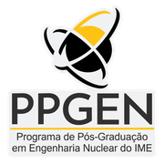

<div align="center">
  
  &nbsp;&nbsp;&nbsp;&nbsp;&nbsp;
  
</div>

<div align="center">

# Geant4 — Simulação Computacional Aplicada à Engenharia Nuclear

**Instituto Militar de Engenharia (IME)**  
**Programa de Pós-Graduação em Engenharia Nuclear (PPGEN)**

*Material didático e aplicação prática de transporte de radiação por Monte Carlo*

</div>

## Sobre este repositório

Este repositório reúne os materiais da aula introdutória ao **Geant4** para a disciplina **Simulação Computacional Aplicada à Engenharia Nuclear**. A proposta é relacionar os conceitos de transporte Monte Carlo já conhecidos pelos alunos, incluindo o uso básico do **MCNP5**, com a arquitetura e a implementação de uma aplicação em **C++** utilizando o Geant4.

O exercício acompanha fótons gama que partem de uma fonte pontual, atravessam uma placa de chumbo e alcançam um detector de silício. O aluno observará o funcionamento das classes da aplicação, a configuração por macros, o procedimento de compilação e a análise estatística dos resultados.

> **Objetivo da prática:** comparar o efeito da **energia do fóton** e da **espessura da blindagem** sobre a chegada de fótons ao detector e a energia depositada no silício.

## Materiais da aula

| Material | Conteúdo |
| --- | --- |
| [Guia de instalação do Geant4 no Windows/WSL](Guia_Instalacao_Geant4_WSL.pdf) | Instalação do WSL 2, Ubuntu 24.04 LTS e Geant4 diretamente do código-fonte, sem Conda. |
| [Roteiro da atividade prática](Geant4Demo/ROTEIRO_ALUNOS.md) | Sequência de exercícios e questões para interpretação dos resultados. |
| [Código-fonte C++](Geant4Demo/src/) e [cabeçalhos](Geant4Demo/include/) | Geometria, fonte, ações do usuário e coleta de dados. |
| [Macros da simulação](Geant4Demo/run_duas_energias.mac) | Parâmetros de execução, energias e número de eventos. |
| [Script de análise](Geant4Demo/tools/analisar_resultados.py) | Organização dos resultados e geração de gráficos. |

## Problema físico

| Elemento | Configuração |
| --- | --- |
| Fonte | Um fóton gama primário por evento; posição `(0, 0, -10 cm)`; direção `+z` |
| Energias | **662 keV** e **1 MeV** |
| Blindagem | Chumbo (`G4_Pb`), seção de `6 × 6 cm²`, centrada em `z = 0` |
| Espessuras | **1 cm** e **3 cm** |
| Detector | Silício (`G4_Si`), `6 × 6 cm²`, espessura de **1 mm**, centrado em `z = +8 cm` |
| Ambiente | World de `40 × 40 × 40 cm³`, preenchido com ar |
| Física | Lista de referência `FTFP_BERT` |
| Estatística da atividade | **20.000 eventos** por configuração |

A fonte é **pontual e monodirecional**, não um feixe amplo. A versão didática utiliza execução **sequencial**, para facilitar a compreensão do fluxo de eventos e do scoring.

## Antes de começar

É necessário ter:

- Windows com **WSL 2 e Ubuntu 24.04 LTS**, ou uma instalação Linux compatível;
- **Geant4 11.x**, compilado e instalado com os dados físicos necessários;
- **CMake 3.16+** e compilador **C++17**;
- opcionalmente, suporte **Qt/OpenGL** para visualização e **Python 3 + Matplotlib** para gráficos.

**Ainda não instalou o Geant4?** Siga primeiro o [guia completo de instalação](docs/Guia_Instalacao_Geant4_WSL.pdf). Para o projeto, não é necessário utilizar Miniforge nem Conda.

## Obter e compilar o projeto

No GitHub, clique em **Code → Copy HTTPS URL**. Abra o terminal do **Ubuntu (WSL)** e substitua `URL_DO_REPOSITORIO` pelo endereço HTTPS copiado:

```bash
git clone URL_DO_REPOSITORIO geant4-ime
cd geant4-ime
```

Se você baixou um ZIP em vez de clonar, extraia-o e abra a pasta que contém `CMakeLists.txt`.

Caso o ambiente do Geant4 ainda não esteja carregado no terminal, execute (ajuste o caminho se a instalação foi feita em outro local):

```bash
source "$HOME/Geant4/geant4-install/bin/geant4.sh"
```

Em seguida, configure e compile a aplicação:

```bash
cmake -S . -B build \
  -DCMAKE_PREFIX_PATH="$HOME/Geant4/geant4-install" \
  -DDEMO_WITH_VIS=ON
cmake --build build --parallel 2
```

A pasta `build/` será criada automaticamente. **Não é necessário recompilar o toolkit Geant4:** os comandos acima compilam apenas a aplicação da aula.

Se o Geant4 foi instalado **sem interface gráfica**, utilize `-DDEMO_WITH_VIS=OFF` na configuração. O modo de execução com macros continua disponível.

### Primeiro teste

Execute a partir da raiz do repositório:

```bash
./build/Geant4Demo test_smoke.mac
```

O programa deve processar **100 eventos**, mostrar um resumo no terminal e criar `resultados.csv` na pasta atual. Esse teste é obrigatório antes da campanha de exercícios.

O código foi preparado para fins didáticos, mas **a compilação e a execução real ainda devem ser verificadas no ambiente Geant4 utilizado na disciplina**.

## Executar as simulações

Para as energias de **662 keV** e **1 MeV** com a espessura de chumbo configurada no código:

```bash
./build/Geant4Demo run_duas_energias.mac
```

A geometria inicial utiliza **1 cm de Pb**. Para realizar a segunda parte do exercício:

1. Abra [`src/DetectorConstruction.cc`](src/DetectorConstruction.cc).
2. Localize a linha `fLeadThickness = 1.0 * cm;`.
3. Altere para `fLeadThickness = 3.0 * cm;` e salve o arquivo.
4. Recompile **somente a aplicação** e repita a macro:

```bash
cmake --build build --parallel 2
./build/Geant4Demo run_duas_energias.mac
```

Assim, serão obtidas as quatro combinações: 662 keV/1 cm, 1 MeV/1 cm, 662 keV/3 cm e 1 MeV/3 cm.

**Atenção:** `resultados.csv` é **acumulativo**. Para iniciar a campanha do zero, renomeie o arquivo criado no teste inicial ou remova apenas esse CSV, preservando os demais arquivos.

### Visualizar a geometria e as trajetórias

Em uma instalação Geant4 com Qt/OpenGL configurado, execute:

```bash
./build/Geant4Demo
```

A aplicação carrega `vis.mac` e utiliza o visualizador OpenGL (`OGL`). A visualização depende do suporte gráfico da instalação e do WSL; sua indisponibilidade não impede as simulações em lote.

## Resultados e análise

O projeto produz dois observáveis principais:

1. **Fração de eventos com chegada de fótons ao detector:** porcentagem de eventos em que ao menos um fóton gama entra no volume do silício. Fótons espalhados também podem ser contados; portanto, essa fração **não é necessariamente a transmissão não colidida** da blindagem.
2. **Energia média depositada no silício por evento:** soma da deposição de energia de todas as partículas no detector, dividida pelo total de eventos, incluindo aqueles com deposição nula.

O arquivo `resultados.csv` inclui as estimativas e respectivas incertezas-padrão estatísticas (1σ). Para exibir a tabela consolidada:

```bash
python3 tools/analisar_resultados.py resultados.csv
```

Para produzir gráficos, instale o Matplotlib se necessário (Ubuntu 24.04):

```bash
sudo apt install python3-matplotlib
python3 tools/analisar_resultados.py resultados.csv --output figuras
```

As figuras são gravadas em `figuras/`. Consulte o [roteiro da atividade](ROTEIRO_ALUNOS.md) para a discussão e as questões propostas.

## Organização dos arquivos

```text
.
├── README.md
├── .gitignore
├── CMakeLists.txt
├── main.cc
├── assets/                     # Logotipos IME e PPGEN
├── docs/                       # Guia de instalação
├── include/                    # Declarações das classes (.hh)
├── src/                        # Implementações (.cc)
├── tools/                      # Análise dos resultados
├── ROTEIRO_ALUNOS.md
├── test_smoke.mac               # Teste rápido (100 eventos)
├── run.mac                      # Simulação de referência
├── run_662keV.mac
├── run_1MeV.mac
├── run_duas_energias.mac        # Campanha com duas energias
└── vis.mac                     # Visualização
```

A pasta `build/`, os executáveis e os resultados produzidos pelos alunos **não devem ser enviados ao repositório**.

## Referências

- [Geant4 — site oficial](https://geant4.web.cern.ch/)
- [Geant4 — documentação](https://geant4.web.cern.ch/documentation/)
- [Microsoft — instalação do WSL](https://learn.microsoft.com/pt-br/windows/wsl/install/)

---

**Material preparado por Diogenes Kreusch Filho**  
Instituto Militar de Engenharia — Programa de Pós-Graduação em Engenharia Nuclear  
Disciplina: **Simulação Computacional Aplicada à Engenharia Nuclear**
